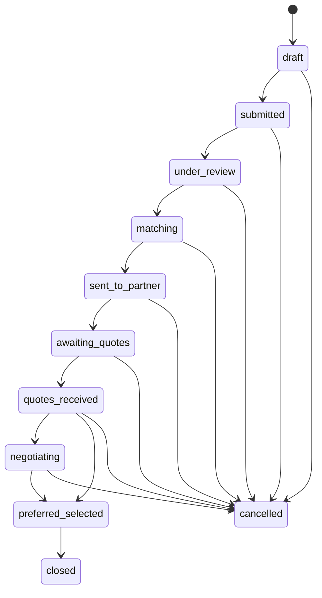

# Phase 6 architecture audit and implementation plan

Baseline: `integration/phase1-4` at `e0781e2302172f8b356dbe74f4543a33d203a75a`. Phase 5 source is the committed local `feature/phase5-supplier-catalogue` at `00a72011ffb7191d7a03f4502cf0e5569beaee96`; the Phase 5 owner still marks contract `p5p6-contract/0.2` **DRAFT**. This Phase 6 branch contains Phase 5's committed files for review, but does not alter them.

## Dependency map

| Phase 6 component | Confirmed Phase 5 dependency | Unsettled seam |
|---|---|---|
| RFQ draft and multi-product lines | `buyer_org_id`, product/variant IDs, submitted `sourcing_request_items.snapshot` | Linked RFQ versus in-place request expansion; custom lines and multi-supplier sharing |
| Supplier matching | approved `partner_profiles`, `suppliers`, published `catalogue_items`, MOQ, lead time and dated availability | Export countries and product certificates are absent from v0.2 and must remain unknown |
| Partner quotations | partner membership and `sourcing:respond`, supplier ownership, numeric prices | Legal issuer and whether a partner may quote for several suppliers |
| Negotiation and samples | existing notifications, audit, private document/scanner pattern | Recipient assignment, attachment authorization and sample states |
| Comparison and preferred selection | persistent RFQ/quote snapshots, exact numeric totals | Cross-currency comparisons and selection concurrency contract |
| Administration | existing scoped admin permissions, conflict checks and audit | Case-based access to private negotiations |
| Erasure | Phase 4 migration `000106` is under local review | Storage object cleanup and Phase 5 history anonymization |

## Proposed state boundaries

These are proposed internal RFQ states; buyer-facing labels should be shorter. Every edge needs an authorized RPC, row lock, expected version and audit event. The Phase 5 `sourcing_requests.status` machine remains unchanged until the identity decision is confirmed.

## Permission boundary

| Action | Buyer org | Approved assigned partner | Other partner | Supplier record | Scoped MITRA staff |
|---|---|---|---|---|---|
| Draft and submit own RFQ | Member with `request:post` | No | No | No login | Operational metadata only |
| Read full RFQ | Own org | Only after assignment/consent | No | No login | Case purpose only |
| Issue or revise formal quote | No | Member with `sourcing:respond`; partner owner MFA | No | Represented by partner | No editing |
| Counteroffer, compare, prefer version | Own org | Reads own counteroffer | No | No login | No editing |
| Private notes and attachments | Own scoped documents | Own scoped documents | No | No login | Case purpose only |
| Suspend abusive activity | No | No | No | No login | Existing scoped admin permission, audited |

The database, not navigation controls, enforces this matrix. Hide unknown records with 404. Do not grant raw SELECT on confidential quotes to all administrators.

## Verification plan

1. Freeze the Phase 5 contract and integrate its reviewed branch. Confirm migration 106 precedes 110 and no Phase 5 version uses 150+.
2. Add only agreed 150+ migrations, with RLS, grants, lock ordering, immutable version tables and pgTAP coverage before UI work.
3. Test multiple buyer/partner organizations, custom products, hidden drafts, exact monetary totals, quote revision races, selection races, expired offers, and denied direct RPC access.
4. Run complete mobile/desktop English, Tamil and Malay sourcing journeys against a fresh isolated database with synthetic users and products.
5. Independently review security-definer functions, RLS, storage access, erasure, audit and translation wording. Then run platform and Astro builds, dependency audit and secret scan.

The only implemented Phase 6 code at this stage is a pure deterministic matching kernel with unit tests. It does not fetch suppliers, rank real users, issue quotations or persist RFQs.
